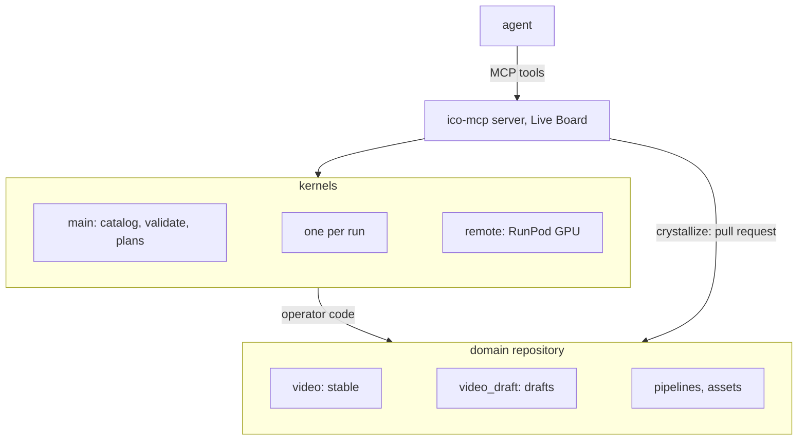

# ico-mcp

[](https://github.com/apriori3d/ico-mcp/actions/workflows/ci.yml)

[](https://opensource.org/licenses/Apache-2.0)

An MCP server on top of [ICO](https://github.com/apriori3d/ico) with which
an agent builds data pipelines from its own operators. The agent writes
operators, small typed Python functions, and composes them into pipelines
as JSON specs; the server checks, runs and profiles them. Operators that
proved themselves in runs become the domain's stable code through a pull
request a human reviews, and the next task starts from them instead of a
blank script.

- **Work accumulates.** Each task adds operators and pipelines to the
  domain's library instead of one-off scripts.
- **Errors before the run.** Types are checked at every link before
  anything runs, so a broken pipeline does not burn GPU time.
- **Fewer tokens.** The agent finds operators as compact cards by input and
  output type instead of reading code, runs saved pipelines by name, and
  gets data back as paths; long runs go on in the background.
- **Visible runs.** The Live Board shows the plan and the progress of every
  node, the profiler where time and memory go, `sample_run` what flows out
  of a node; a run can be cancelled between items.
- **Local or GPU.** The same pipeline runs here or on a RunPod GPU: the job
  carries the operators' code, model weights are pinned assets.

```
search_operators → validate → run → save_pipeline → crystallize → PR
       a step is missing → propose_operator, propose_types
```

## How it is built



**Server.** Speaks MCP over stdio, never imports operator code, hosts the
Live Board and keeps the runs.

**Kernels.** Child processes in the domain's environment that import the
operators: a main one for the catalog and validation, one per run (so a run
can be cancelled alone), and a remote one that sends a run with its
operators' code to a RunPod Serverless GPU.

**Domain.** A repository of its own, created by `ico-mcp init`: stable and
draft packages, saved pipelines, pinned model weights (assets), notes for
agents.

**Crystallization.** `crystallize` moves the drafts a pipeline uses into the
stable package, checks them (pyright strict, examples, saved pipelines
validate) and opens a pull request with the operator cards and the runs that
used them.


## Tools

| Tool | Does |
| --- | --- |
| `search_operators`, `get_operator` | find operators by input / output type, text, tags; a card with the source |
| `list_types`, `get_type` | domain types with fields and docstrings |
| `validate` | type-check a spec; issues carry their place in the spec |
| `run`, `run_status`, `wait_run`, `cancel_run`, `sample_run`, `fetch_run` | run a spec or a saved pipeline, locally or on a target; follow, stop, sample it; finish a remote run that lost its stream |
| `dashboard` | the URL of the Live Board |
| `save_pipeline`, `list_pipelines`, `get_pipeline`, `delete_pipeline` | saved, validated specs with parameters |
| `propose_operator`, `propose_types`, `delete_module` | write, edit or remove a draft module |
| `crystallize`, `wait_crystallize` | a pull request that makes drafts stable |
| `assets_status`, `fetch_assets` | the weights a pipeline needs, here or on a target |
| `volume_up`, `volume_down` | the network volume of an order on a RunPod target |
| `environment`, `guide`, `reload`, `server_status` | what operators see, the reference for agents, reload after a merge, a stale server |

## Setup

Requires Python 3.11 or 3.12 and [uv](https://docs.astral.sh/uv/);
[gh](https://cli.github.com) for `crystallize`. Create a domain:

```bash
uvx ico-mcp init /abs/path/to/ico-mcp-video --package video
```

It depends on `ico-mcp` and [`apriori-ico`](https://pypi.org/project/apriori-ico/)
(ICO). Add the domain's dependencies to its `pyproject.toml`, `uv sync`
there, and connect it:

```bash
claude mcp add video -- uv run --project /abs/path/to/ico-mcp-video ico-mcp --root /abs/path/to/ico-mcp-video
```

In the Claude desktop app, put the same server into
`claude_desktop_config.json` with the absolute path of `uv`.

For development, check out ICO next to this repository (`../ico`) and run
`uv sync` and `make ci` here; `ico-mcp init` from this checkout makes a
domain that uses both checkouts.

Design notes: [docs/design/ico-mcp.md](https://github.com/apriori3d/ico-mcp/blob/main/docs/design/ico-mcp.md). The guide
for agents: [src/ico_mcp/agent-guide.md](https://github.com/apriori3d/ico-mcp/blob/main/src/ico_mcp/agent-guide.md).

## License

Apache License 2.0, see [LICENSE](https://github.com/apriori3d/ico-mcp/blob/main/LICENSE).
