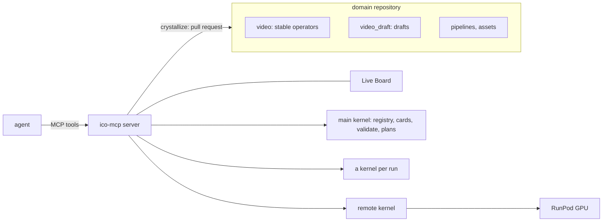

# ico-mcp

[](https://github.com/apriori3d/ico-mcp/actions/workflows/ci.yml)

[](https://opensource.org/licenses/Apache-2.0)

An MCP server on top of [ICO](https://github.com/apriori3d/ico). An agent
builds pipelines from a domain's registry of typed operators, runs them
locally or on a cloud GPU and follows them on the Live Board, writes the
operators that are missing as drafts, and turns the drafts that proved
useful into stable operators through a pull request that a human reviews.

```
search_operators → validate → run ─┬─ works ─→ save_pipeline → crystallize → PR → merge → reload
                                   └─ step missing → propose_operator / propose_types
```

Operators are not MCP tools: the tool set is fixed, and the agent finds
operators as compact cards by input and output type. Data crosses the JSON
boundary by reference (paths).

## How it is built



**The server** speaks MCP over stdio and never imports operator code. It
hosts the Live Board, keeps the runs, and answers what does not need the
operators.

**Kernels** are child processes with the domain's interpreter that import
the operators. A main kernel serves the catalog: search, cards, types,
validation, plans. Every run gets a kernel of its own that loads only the
modules its spec uses, so a run can be cancelled (between items, killed
after a grace period) without touching the others.

**The domain is a repository of its own**, created by `ico-mcp init`: its
stable package, a draft package, saved pipelines, examples, notes for agents
(`docs/domain.md`), assets and dependencies. It depends on the `ico-mcp`
package, so server fixes reach it by a version bump.

**Drafts and crystallization.** The agent writes drafts with
`propose_operator` / `propose_types`, in checked stages: write, pyright,
load, register, examples. `crystallize` moves the modules of the given
operators (with the drafts they import) and the saved pipelines that use
them into the stable package in a worktree of its own, runs a gate (load,
pyright strict, no draft imports from stable code, the examples, every
saved pipeline validates), pushes and opens a pull request with the
operator cards, the gate report and the runs that used them. After the
merge, `reload` retires the drafts.

**Runs and the Live Board.** `run` returns the outputs and the URL of the
board: the progress of every node, the plan, and with `profile=true` the
time of every node and the models each process holds. A run longer than
`timeouts.wait` (45 s) goes on in the background: `wait_run`, `cancel_run`,
and `sample_run` for what flows out of a node meanwhile.


**Remote runs.** `run(target=...)` sends a run to a RunPod Serverless
endpoint from `ico.toml`. The job carries the code of the operators it uses,
drafts included; local files go up and the outputs come back into
`runs/<run_id>/out/`; the board shows the plan, the RunPod queue and the
progress as for a local run. A target without storage works on the network
volume of an order (`volume_up` / `volume_down`), which also holds the
model weights (`fetch_assets(target=...)`).

**Assets.** Model weights are pinned in the domain (`assets.toml`,
`assets.lock`); `validate` warns about missing ones with their size, and
`fetch_assets` downloads them only on the human's word.

## Tools

| Tool | Does |
| --- | --- |
| `search_operators`, `get_operator` | find operators by input / output type, text, tags; a card with the source |
| `list_types`, `get_type` | domain types with fields and docstrings |
| `validate` | type-check a spec; issues carry their place in the spec |
| `run`, `run_status`, `wait_run`, `cancel_run`, `sample_run` | run a spec or a saved pipeline, locally or on a target; follow, stop, sample it |
| `dashboard` | the URL of the Live Board |
| `save_pipeline`, `list_pipelines`, `get_pipeline`, `delete_pipeline` | saved, validated specs with parameters |
| `propose_operator`, `propose_types`, `delete_module` | write, edit or remove a draft module |
| `crystallize`, `wait_crystallize` | a pull request that makes drafts stable |
| `assets_status`, `fetch_assets` | the weights a pipeline needs, here or on a target |
| `volume_up`, `volume_down` | the network volume of an order on a RunPod target |
| `environment`, `guide`, `reload`, `server_status` | what operators see, the reference for agents, reload after a merge, a stale server |

## Setup

Requires Python 3.11 or 3.12, [uv](https://docs.astral.sh/uv/), a checkout
of ICO next to this one (`../ico`, an editable dependency during
development), and [gh](https://cli.github.com) for `crystallize`.

```bash
uv sync
make ci        # ruff, pyright strict, tests (no network)
```

Create a domain:

```bash
uv run ico-mcp init /abs/path/to/ico-mcp-video --package video
```

It writes `ico.toml` (name, `about` for the agents' instructions, the GitHub
repository for pull requests, timeouts, targets), `pyproject.toml`, the
`video` and `video_draft` packages, `pipelines/`, `examples/`, the examples
test, `docs/domain.md` and `.mcp.json`. Add the domain's dependencies to its
`pyproject.toml` and run `uv sync` there: operators run in that environment.

Connect a client. The server runs in the domain's environment and serves the
domain given by `--root` (else the nearest `ico.toml`):

```bash
claude mcp add video -- uv run --project /abs/path/to/ico-mcp-video ico-mcp --root /abs/path/to/ico-mcp-video
```

or the `.mcp.json` written by `init`. In the Claude desktop app, put the same
`mcpServers` block in `claude_desktop_config.json` with the absolute path of
`uv` (the app does not inherit the shell's `PATH`).

Design notes: [docs/design/ico-mcp.md](docs/design/ico-mcp.md). The guide
for agents: [src/ico_mcp/agent-guide.md](src/ico_mcp/agent-guide.md).

## License

Apache License 2.0, see [LICENSE](LICENSE).
